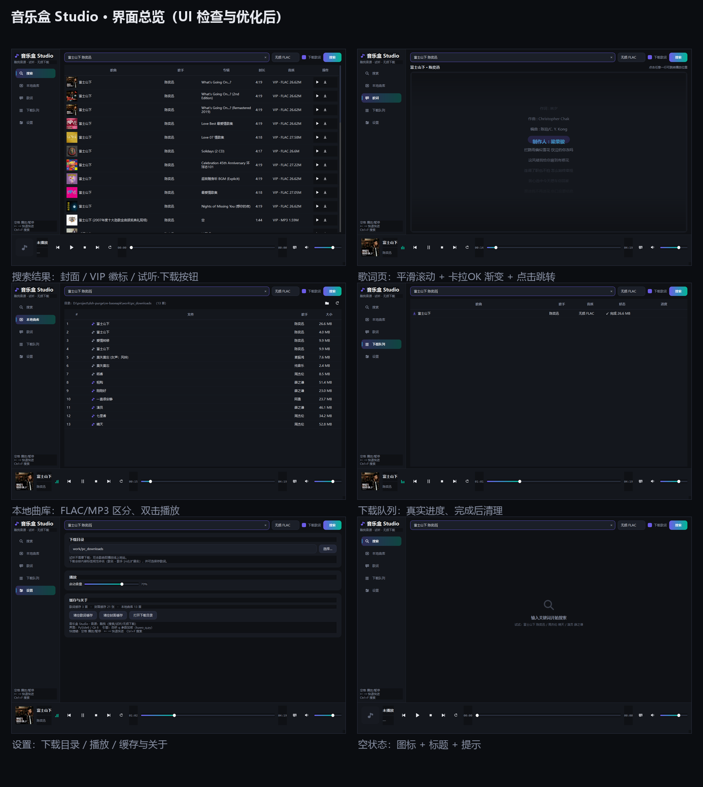

# 音乐盒 Studio · kwmc-q

> 一个基于**酷我音源**的现代桌面音乐播放器：在线搜索 · 直接试听 · 无损下载 · 本地曲库 · 动画歌词
> 界面 PySide6 / Qt 6，纯 Python 实现，可打包成免安装 exe。



---

## ✨ 功能

| 模块 | 说明 |
| --- | --- |
| **搜索** | 歌曲 / 歌手 / 专辑 / 混合关键词；结果带**专辑封面**、`VIP` 徽标、**可用音质与体积**（如 `VIP · FLAC 26.6M`） |
| **试听** | 双击即播**线上流媒体**，无需先下载（QtMultimedia + FFmpeg 后端） |
| **下载** | 无损 FLAC / 320k / 128k MP3，**真实进度条**，按内嵌标签自动规范命名，可选保存 `.lrc` |
| **歌词** | 独立歌词页：**平滑滚动 + 卡拉OK 渐变填充 + 切行弹入动画 + 点击跳转**；四级降级 + 磁盘缓存 |
| **本地曲库** | 自动扫描下载目录，FLAC/MP3 区分图标，双击播放、右键定位/删除 |
| **播放条** | 上一首/播放暂停/停止/下一首/播放模式、进度拖动、音量与静音、律动指示 |
| **设置** | 下载目录、启动音量、缓存统计与清理、关于 |

全部图标为 **QPainter 矢量自绘**（不依赖 emoji/字体，任意尺寸颜色都锐利一致）。

---

## 🚀 快速开始

### 源码运行
```bash
pip install PySide6            # 仅此一个依赖
python kuwo_app.py             # 或双击 启动音乐盒.bat
```

### 打包成免安装 exe
```bash
双击 打包-单文件.bat           # → dist\音乐盒Studio-单文件版.exe（一个文件，可直接发给别人）
双击 打包-单目录.bat           # → dist\音乐盒Studio\（文件夹版，启动更快，需整个文件夹一起发）
```
> ⚠️ 单目录版**不能只发 exe**（缺 `_internal` 会报 `Failed to load Python DLL`），详见
> [docs/怎么发给别人用.md](docs/怎么发给别人用.md)

### 自检 / 复现截图
```bash
python tools/app_test.py       # 端到端：搜索 / 试听 / 下载 / 歌词 / 队列
python tools/app_shots.py      # 渲染各页截图（窗口移到屏幕外）
python tools/ui_audit.py       # 图标/文字/歌词的数值化体检
```

---

## 🧩 技术架构

```
kuwo_app.py            PySide6 主程序（页面 + 播放条 + 线程模型 Engine）
ui_kit.py              界面组件库：矢量图标 / 图标按钮 / 动画歌词 / 律动条 / 空状态 / Toast / Spinner
kuwo_pc_download.py    引擎：搜索解析 / 播放地址解析 / 分块下载 / 歌词多级降级 / FLAC 标签
kuwo_q.py              酷我 q 参数加解密（自定义 DES 变体，密钥 ylzsxkwm）
tools/                 开发与验证脚本（测试、截图、体检、图标生成）
docs/                  使用说明与技术报告
```

几个关键点：

* **q 参数加密**：酷我私有接口用自定义 DES 变体（自定义 S 盒 `MATRIXNSBOX` 与置换表），
  **标准 DES 库无法解开**（曾暴力枚举 20 万+ 候选全部失败）。本项目移植了开源实现后，
  可实现「PC 端纯离线生成 q」→ 搜索、解析播放地址、取歌词全部只需 Python 标准库。
* **搜索解析容错**：接口返回的 JSON 里存在**未转义双引号**（如 `"ALBUM":"What"s Going On...?`），
  会导致 `json.loads` 直接失败 → 表现为"某些歌搜不到"。现改为**严格 JSON 失败则按条目扫描取值**。
* **歌词四级降级**：酷我 `http` H5 → 酷我 `https` H5 → App 加密通道 → 网易云兜底，
  并落盘缓存（`%LOCALAPPDATA%\MusicBoxStudio\lyrics`）。
* **界面动画**：统一 60fps 定时器 + 缓动插值（歌词滚动、切行弹入、导航指示条、Toast 淡入）。
* **线程模型**：网络操作全部在 `QThread` 中，通过信号回主线程，界面不卡顿。

更详细的分析见：
- [docs/技术报告-算法与纯离线管线.md](docs/技术报告-算法与纯离线管线.md)
- [docs/技术报告-加密算法与接口.md](docs/技术报告-加密算法与接口.md)
- [docs/修复记录-搜索解析.md](docs/修复记录-搜索解析.md)
- [docs/UI检查与优化报告.md](docs/UI检查与优化报告.md)

---

## 🙏 致谢与引用的开源项目

本项目的**加密算法实现**与部分接口思路来自以下开源项目，特此致谢（按贡献程度排序）：

| 项目 | 本项目用到了什么 |
| --- | --- |
| **[JayZorn-LJZ/GetFreeMusicYourself](https://github.com/JayZorn-LJZ/GetFreeMusicYourself)** | ⭐ **核心**：`kuwo_query_encryption.py` 提供了 q 参数加密算法的完整实现（自定义 DES 变体、S 盒与置换表）。本项目的 `kuwo_q.py` 是在其基础上移植/整理而来 |
| **[CharlesPikachu/musicdl](https://github.com/CharlesPikachu/musicdl)** | 多平台音乐下载器的接口组织方式，搜索/下载字段与参数命名参考 |
| **[zhiyYo/Groove](https://github.com/zhiyYo/Groove)** | 专辑封面地址拼接方式（`web_albumpic_short` → `img1.kuwo.cn/star/albumcover/...`） |
| **[listen1/listen1_chrome_extension](https://github.com/listen1/listen1_chrome_extension)** | 多音源聚合与接口适配的总体思路 |
| **[UnblockNeteaseMusic/server](https://github.com/UnblockNeteaseMusic/server)** | 音源降级/替换（fallback）思路，歌词兜底方案参考 |
| **[sdbabd/QQKWKG-TriMusicDecrypt](https://github.com/sdbabd/QQKWKG-TriMusicDecrypt)** | 音乐平台加解密与接口逆向的参考资料 |

使用的开源软件与库：

| 组件 | 用途 | 许可 |
| --- | --- | --- |
| [PySide6 / Qt 6](https://www.qt.io/qt-for-python) | 界面与多媒体播放 | LGPL v3 |
| [FFmpeg](https://ffmpeg.org/)（经 Qt Multimedia 调用） | 音频解码（MP3 / FLAC / 流式 HTTP） | LGPL v2.1+ |
| [PyInstaller](https://pyinstaller.org/) | 打包为独立 exe | GPL v2 + 例外条款 |
| [Pillow](https://python-pillow.org/) | 图标生成、界面截图拼版 | MIT-CMU |

界面设计上参考了 Spotify / Apple Music 的深色布局，以及 [VutronMusic](https://github.com/stark81/VutronMusic)、
[MusicFree](https://github.com/maotoumao/MusicFree)、[FeelUOwn](https://github.com/feeluown/FeelUOwn)
等开源播放器的功能组织方式（仅作设计参考，未使用其代码）。

---

## ⚠️ 免责声明

* 本项目**仅供个人学习、研究与技术交流**，用于学习网络协议分析、加解密算法与桌面 GUI 开发；
* 所有音乐内容与接口版权归**原版权方（酷我音乐及其版权方）**所有，本项目不存储、不分发任何音乐内容；
* 请勿将本项目用于商业用途或大规模分发下载内容；使用产生的任何后果由使用者自行承担；
* 若相关权利方认为本项目不妥，请联系删除。

---

## 📄 许可

本项目代码以 **MIT License** 发布（见 [LICENSE](LICENSE)）。
注意：`kuwo_q.py` 的算法实现移植自上述开源项目（[GetFreeMusicYourself](https://github.com/JayZorn-LJZ/GetFreeMusicYourself)），
该部分请一并遵守原项目的许可与声明。
